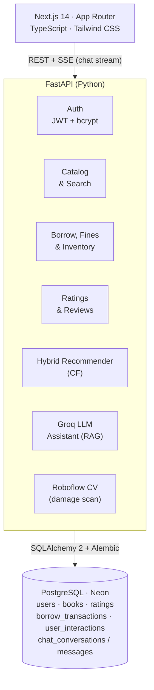
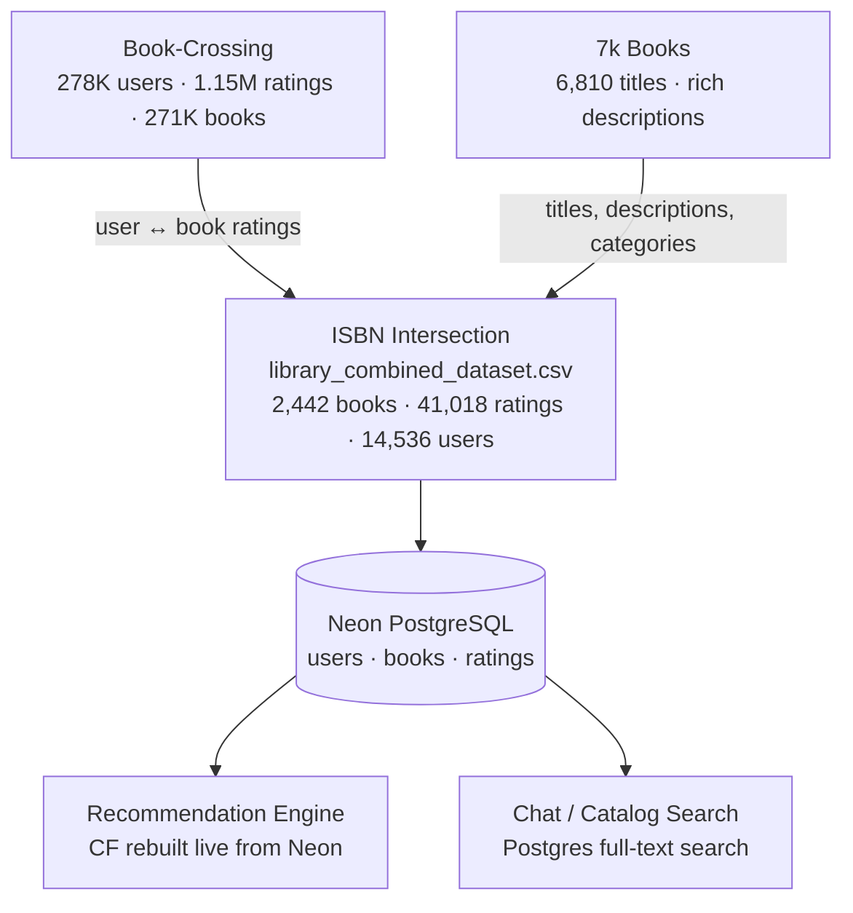
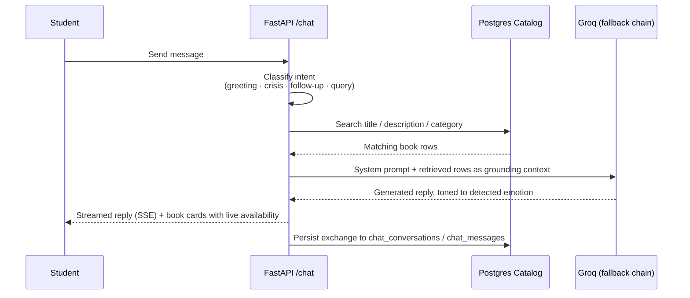
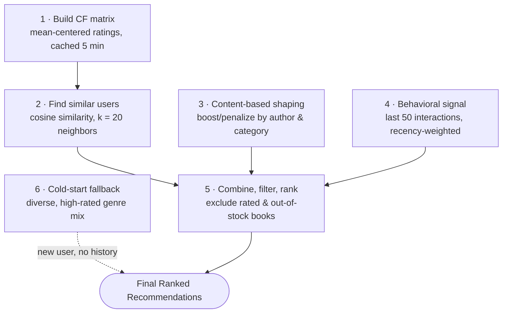

<div align="center">

# 📚 Library Portal

### A full-stack library management and discovery platform

Students browse a ~2,400-title catalog, borrow and return books, get hybrid AI-powered recommendations, and chat with a RAG-based library assistant. Admins get a full operations console for inventory, fines, demand forecasting, and computer-vision-based damage inspection.

<p>


</p>

</div>

---

## Table of Contents

- [Why This Project Exists](#why-this-project-exists)
- [System Architecture](#system-architecture)
- [Tech Stack](#tech-stack)
- [Core Features](#core-features)
- [The ML System: Two Datasets, One Catalog](#the-ml-system-two-datasets-one-catalog)
- [Database Schema](#database-schema)
- [Business Logic Highlights](#business-logic-highlights)
- [API Surface](#api-surface)
- [Repository Structure](#repository-structure)
- [Getting Started](#getting-started)
- [Environment Variables](#environment-variables)
- [Engineering Decisions and Trade-offs](#engineering-decisions-and-trade-offs)
- [Roadmap](#roadmap)

---

## Why This Project Exists

University libraries typically solve "is this book available?" with a dusty index card system or, at best, a static catalog page. Students end up walking to the library, checking a shelf, walking back, often to find the book was never returned or is buried in a backlog. This project reframes a library as a **product**: real-time availability, personalized discovery, conversational search, and data-driven inventory decisions for staff, all backed by a single source of truth in Postgres, with **all data access routed through a typed FastAPI layer** (the frontend never touches the database directly).

## System Architecture



Every route is mounted twice, at the root and under `/api`, so integrations can hit either `/auth/login` or `/api/auth/login` without breaking.

## Tech Stack

| Layer | Technologies |
|---|---|
| **Frontend** | TypeScript, React 18, Next.js 14 (App Router), Tailwind CSS 3, lucide-react |
| **Backend** | Python, FastAPI 0.141, Uvicorn, Pydantic 2, SQLAlchemy 2.0, Alembic |
| **Database** | PostgreSQL (Neon), `psycopg2-binary` |
| **Auth** | JWT (PyJWT, HS256, 7-day expiry), bcrypt, with transparent legacy-hash upgrade on login |
| **ML / Recommendations** | NumPy, pandas, SciPy sparse matrices, scikit-learn cosine similarity |
| **LLM** | Groq SDK with a 4-model fallback chain (`gpt-oss-120b → compound-mini → allam-2-7b → qwen3.6-27b`) |
| **Computer Vision** | Roboflow Workflows API for automated book-damage inspection |
| **Data Import** | pandas over a combined CSV, mapped into normalized SQL tables |

## Core Features

### For Students
- **Catalog search** across title, author, description, and ISBN with query expansion, typo tolerance, and a synonym map, not a naive `LIKE '%query%'`
- **Borrow / return** with a 14-day default loan, real-time copy availability, and "notify me when available"
- **Mandatory return-with-inspection flow**: every return requires a photo upload; there is no "return without inspection" path. Roboflow scores the image for damage, and the backend, never the client, computes any resulting fine. Because every return is tied to a photo and a specific roll number, damage is always attributable to the student who actually caused it, so no other student can be wrongly blamed or fined for it
- **Ratings & reviews**, gated so only students who actually borrowed a book can rate it
- **Hybrid recommendations** blending collaborative filtering with recent behavior
- **Conversational library assistant** with streaming responses, emotion-aware tone, and book cards with live availability

### For Admins
- Operational overview: active/overdue loans, fine totals, inventory health
- Full catalog CRUD, fine imposition/waiver/payment
- **Demand analytics engine** that scores every title (`borrows×5 + interactions×2 + unmet_demand×8 + ratings_count×0.05 + avg_rating`) and classifies it as `URGENT_RESTOCK`, `LOW_STOCK`, `OPTIMAL`, `LOW_DEMAND`, or `OVERSTOCKED`, with a suggested restock quantity
- Damaged-returns log with aggregate fine totals, sourced directly from the CV pipeline

## The ML System: Two Datasets, One Catalog

The most interesting engineering decision in this project is that the **recommendation model and the semantic-search / RAG model were never trained on the same dataset**, because no single public dataset has both rich user to item rating signals *and* rich book-description text.

| Need | What the model needs | Dataset used |
|---|---|---|
| Collaborative filtering (recommendations) | User to book ratings at scale | **Book-Crossing** (278K users, 1.15M ratings, 271K books) |
| Semantic search / RAG chatbot | Titles, descriptions, categories | **7k Books** (6,810 titles, Google Books style metadata) |

**Book-Crossing** has almost no plot/description text; it's built for "who rated what," not "what is this book about." **7k Books** has rich descriptions but no user IDs and no per-user ratings; it's built for content, not behavior. Each dataset is structurally incapable of doing the other's job, so two independent modeling tracks were built:

**Track 1: Collaborative Filtering** (`recommendation` notebook)
- Kept only explicit ratings (1 to 10); the implicit `0` rating in Book-Crossing means "touched, not scored," not "disliked," so those rows were excluded from CF training
- Iterative filtering to users/books with 5 or more ratings each, taking density from about 0.0038% to about 0.185%
- User-based collaborative filtering via cosine similarity over a sparse user to item matrix (**6,851 users × 9,085 books** in the notebook's filtered matrix)

**Track 2: Semantic Retrieval** (`llm` notebook)
- `sentence-transformers/all-MiniLM-L6-v2` embeddings over book descriptions, indexed with **FAISS** for nearest-neighbor retrieval
- `j-hartmann/emotion-english-distilroberta-base` for conversational tone detection
- Groq LLM for generation, with retrieved catalog rows injected into the prompt (RAG, not fine-tuning)

**The intersection.** To ship *one* production catalog that supports both jobs, the deployed dataset (`library_combined_dataset.csv`) is the **ISBN intersection** of the two sources: 7k Books' metadata joined against Book-Crossing's ratings for the same ISBNs. This yields 2,442 books with 41,018 rating rows across 14,536 users, smaller than either source alone, but the only subset where every book simultaneously has *both* a description (for search/chat) *and* real user ratings (for CF).



*Production note: the live recommender rebuilds CF from the 2,442-book intersection in Neon, not the notebook's larger 9K-book matrix, and production chat search does not call the notebook's FAISS index.*

The recommender's Neon matrix also picks up fresh in-app ratings on top of the intersection, cached for 5 minutes. Live emotion detection uses keyword rules rather than DistilRoBERTa. The notebooks were the research phase; the API layer is a leaner, latency-conscious reimplementation informed by them. The exact model-by-model breakdown is below.

### AI Components, Model by Model

**Semantic search embedding model (research): `sentence-transformers/all-MiniLM-L6-v2`**
A lightweight pretrained sentence-transformer that maps text into a 384-dimensional dense vector. In `finalll.ipynb`, every book's description is encoded this way, and all ~6.5K vectors are indexed with **FAISS** (`IndexFlatL2`). At query time, the same model encodes the user's question, and FAISS returns the nearest book vectors by distance. This is *semantic* search: it can match "a detective solving a murder in Paris" to a relevant book even if none of those exact words appear in its description. This is the notebook/research retrieval path; see the production note below for what the deployed API actually calls at request time.

**Emotion-detection model (research): `j-hartmann/emotion-english-distilroberta-base`**
A DistilRoBERTa checkpoint fine-tuned for multi-class emotion classification, evaluated in the notebook to tag a user's chat message with one of: horror, comfort, frustration, sadness, anger, fear, joy, curiosity, neutral. Production reimplements this as a keyword-rule classifier mapped to the same categories, trading a small amount of nuance for zero model-serving latency and cost on every chat message. This is a deliberate trade-off given the assistant is meant to feel instant.

**Generation model (production): Groq-hosted LLMs, a 4-deep fallback chain**
Groq is the inference *provider*. It serves open-weight models on custom LPU hardware at very high tokens/sec, which is what keeps the streaming chat feeling closer to real-time than typical LLM API latency. The assistant tries, in order, until one succeeds:

1. `openai/gpt-oss-120b`: primary, highest-quality responses
2. `groq/compound-mini`: first fallback if the primary is rate-limited or errors
3. `allam-2-7b`: second fallback
4. `qwen/qwen3.6-27b`: final LLM fallback

If every model in the chain fails, the backend drops to a **local, non-LLM template response** built directly from the Postgres search hits, so the chat feature degrades gracefully instead of going fully offline.

**Production retrieval (what actually runs on `/chat`):** the deployed API does *not* call MiniLM or FAISS at request time. Instead it queries Postgres directly, using the same title/description/category matching and query-expansion logic used by `/books`, to fetch candidate rows. This keeps chat latency low and avoids paying transformer-inference cost on every message. The notebook's MiniLM+FAISS pipeline was the proof-of-concept that validated semantic retrieval was worth building before this cheaper production path was chosen.

### How a Chat Response Actually Gets Generated (RAG Flow)



1. Student sends a message to `POST /chat` or `POST /chat/stream`.
2. The backend classifies intent first: greeting/acknowledgment, a crisis/self-harm keyword (short-circuits straight to helpline text, no LLM call, no book suggestions), a follow-up about a book already suggested earlier in the session, or a genuine library query.
3. For a genuine query, the backend searches the Postgres catalog (title, description, categories, with query expansion) and pulls the matching rows.
4. Those rows are serialized to JSON and injected directly into the Groq system prompt as grounding context. **This is the "retrieval-augmented" part.** The LLM is handed the actual books that exist in the catalog rather than being expected to recall or invent one.
5. The next available model in the Groq fallback chain generates a natural-language reply from that context, toned to the detected emotion.
6. The reply streams token by token over SSE (or returns in one shot for the non-streaming endpoint), renders as Markdown on the frontend, and any book mentioned is shown as a card with a **live** availability check, not a stale snapshot from the prompt.
7. The full exchange persists to `chat_conversations` / `chat_messages`, so a logged-in student's history survives across sessions.

### Recommendation Engine: the Full Process

The `/recommendations` endpoint isn't one algorithm. It's four independent signals computed and merged at request time in `app/ml/recommendation.py`, built on NumPy, pandas, SciPy sparse matrices, and scikit-learn.



**Step 1: Build the collaborative-filtering matrix.** All ratings in the `ratings` table are loaded into a sparse user × book matrix. Each user's ratings are mean-centered (subtracting their personal average), so a generous 3-star rater and a harsh 3-star rater get compared fairly. This matrix is rebuilt from Neon and cached for 5 minutes, so it reflects live in-app ratings, not a frozen offline snapshot.

**Step 2: Find similar users.** scikit-learn's cosine similarity is computed between the target student's rating vector and every other user's vector. The **k = 20 most similar users** are kept, and their ratings on books the target student hasn't read yet are aggregated, weighted by similarity, into a predicted-interest score per book. This is classic user-based collaborative filtering.

**Step 3: Layer in content-based preference shaping.** Independently of CF, the engine looks at the student's own rating history: books rated **4 or higher** boost other books by the same author or category; books rated **2 or lower** penalize the same author/category. This compensates for a known CF weakness: CF alone reacts slowly to a student's most recent, most decisive opinions.

**Step 4: Layer in behavioral signal.** The student's last 50 logged `user_interactions` (searches, book views/explores, chat messages, and books the chatbot itself suggested) are pulled and **recency-weighted**, so a search from five minutes ago outweighs one from three weeks ago. Keywords extracted from that activity nudge scores toward genres/authors the student is *currently* browsing, which a ratings-only model would completely miss.

**Step 5: Combine, filter, rank.** The CF score, the author/category boost or penalty, and the behavioral keyword match are merged into one ranked list. Books the student has already rated are excluded, and, critically, **out-of-stock books are filtered from the primary feed**, since recommending a title with zero copies available would just frustrate the student.

**Step 6: Cold start.** A brand-new student has no rating history and no CF neighbors, so the engine falls back to a diversity-aware mix of high-average-rating books spanning multiple genres. That first click starts generating Step 4's behavioral signal, and the engine gets sharper from there.

**Transparency endpoints.** `GET /recommendations/signals` exposes the raw counts behind a student's current recommendations (ratings, explores, searches, chats used), and `POST /recommendations/track` is what logs each new interaction as the student uses the app, so the model keeps improving continuously, not just after an explicit star rating.

## Database Schema

| Table | Purpose |
|---|---|
| `users` | Roll number as PK, bcrypt password hash, `is_admin` flag |
| `books` | ISBN-10 PK, metadata, `total_copies` (default 5), rolling `average_rating` |
| `ratings` | One rating per (user, book); only insertable after a borrow |
| `borrow_transactions` | Loan lifecycle, due dates, fines, and damage detection results |
| `user_interactions` | Behavioral event log feeding recommendations and admin demand analytics |
| `chat_conversations` / `chat_messages` | Persistent per-user chat history with session titles and emotion tags |

**Inventory rule:** `copies_available = total_copies − active_loans`, with a deterministic hash-based fallback if the database is temporarily unreachable, so availability never silently disappears from the UI.

## Business Logic Highlights

- **Fines**: ₹10 base + ₹10/day overdue; +₹100 if Roboflow flags damage at 0.30 confidence or higher (excluding benign labels like "undamaged"). New borrows are blocked once a student's unpaid fines reach ₹50: a student with an outstanding damage fine cannot rent another book until it's paid.
- **Fine amounts are always computed server-side.** The return-with-inspection endpoint never trusts a client-submitted figure.
- **Photo upload on return is mandatory, not optional.** This is the accountability mechanism for damage claims: since every return is inspected and logged against the returning student's roll number, the system can pin damage to the student who actually caused it, rather than the library staff guessing or the next borrower being blamed for damage they didn't cause.
- **Ratings are borrow-gated**: you cannot review a book you never checked out (admins exempted), which keeps the ratings signal honest for the recommender.
- **Chat safety**: a keyword-based crisis filter intercepts self-harm-adjacent queries and returns helpline information instead of book suggestions.

## API Surface

All endpoints are mirrored under both `/` and `/api/`.

| Domain | Endpoints |
|---|---|
| Auth | `POST /auth/register`, `POST /auth/login`, `GET /auth/me` |
| Catalog | `GET /books`, `GET /books/categories`, `GET /books/{isbn10}` |
| Ratings | `POST /ratings`, `GET /ratings/book/{isbn10}`, `GET /ratings/me` |
| Recommendations | `GET /recommendations`, `POST /recommendations/track`, `GET /recommendations/signals` |
| Chat | `POST /chat`, `POST /chat/stream` (SSE), session CRUD under `/chat/sessions` |
| Borrowing | `GET /borrows/my`, `POST /borrows/borrow`, `POST /borrows/return/{id}`, `POST /borrows/return-with-inspection/{id}` (multipart) |
| Admin | overview, borrow issue/return, fines, demand analytics, catalog CRUD, inventory verify, damaged-returns |
| Ops | `GET /health` |

## Repository Structure

```
LibraryPortal/
├── backend/
│   ├── app/
│   │   ├── main.py                 # FastAPI app, CORS, router mounting
│   │   ├── core/                   # config, JWT/bcrypt, auth deps, inventory math
│   │   ├── database/connection.py  # SQLAlchemy engine, Session, Base
│   │   ├── models/                 # ORM tables
│   │   ├── schemas/                # Pydantic request/response models
│   │   ├── routes/                 # FastAPI routers
│   │   ├── services/                # business logic (fines, inventory, roboflow)
│   │   └── ml/                      # recommendation.py, llm_assistant.py
│   ├── alembic/versions/           # schema migrations
│   ├── data/library_combined_dataset.csv
│   ├── scripts/                    # import, seeding, tests
│   ├── ml_models/                  # research notebooks (CF + LLM/RAG)
│   └── requirements.txt
└── frontend/
    ├── app/                        # /, /login, /books, /recommendations, /chat, /admin
    ├── components/                 # Navbar, BookCard, BookDetailModal, MyBorrowsModal
    ├── services/api.ts             # REST + SSE client
    └── types/index.ts
```

## Getting Started

### Backend

```bash
cd backend
python -m venv .venv
source .venv/bin/activate
pip install -r requirements.txt

# create backend/.env with:
# DATABASE_URL=...
# JWT_SECRET=...
# GROQ_API_KEY=...
# ROBOFLOW_API_KEY=...

uvicorn app.main:app --reload
```

Import the catalog once the database is configured:

```bash
python scripts/import_dataset.py
```

### Frontend

```bash
cd frontend
npm install

# frontend/.env.local:
# NEXT_PUBLIC_API_URL=http://localhost:8000

npm run dev
```

Then visit `http://localhost:3000` (frontend) and `http://localhost:8000/health` (backend health check).

## Environment Variables

**Backend**

| Variable | Purpose |
|---|---|
| `DATABASE_URL` | Postgres/Neon connection string |
| `JWT_SECRET` | Required to mint and verify tokens |
| `JWT_ALGORITHM` | Default `HS256` |
| `JWT_EXPIRE_MINUTES` | Default `10080` (7 days) |
| `GROQ_API_KEY` | Chat LLM |
| `ROBOFLOW_API_KEY` | Damage inspection |
| `ROBOFLOW_WORKSPACE` | Default `amvi` |
| `ROBOFLOW_WORKFLOW_ID` | Book-damage detection workflow |

**Frontend**

| Variable | Purpose |
|---|---|
| `NEXT_PUBLIC_API_URL` | Backend base URL (defaults to `http://localhost:8000`) |

## Engineering Decisions and Trade-offs

- **API-only data access**: the frontend holds zero database credentials and no direct DB client. Every read and write goes through validated Pydantic schemas, which keeps fine calculation, inventory math, and auth checks impossible to bypass from the client.
- **Legacy hash migration on login**: seed users imported with SHA-256 hex hashes are verified and silently upgraded to bcrypt on their next successful login, avoiding a disruptive forced password reset for 14K+ seeded accounts.
- **CF matrix cached, not recomputed per request**: a 5-minute cache on the collaborative-filtering matrix balances recommendation freshness against the cost of recomputing cosine similarity across the full ratings table on every page load.
- **Two independent ML notebooks, one production reimplementation**: rather than forcing one dataset to do both jobs (which would mean either no descriptions for RAG or no rating signal for CF), the research phase kept the tracks separate, and the deployed system unifies them at the data layer via the ISBN intersection, a smaller but *dual-purpose* catalog.
- **RAG over fine-tuning**: the chat assistant injects retrieved catalog rows into the Groq prompt rather than fine-tuning a model on the catalog, so new or edited books are searchable immediately with no retraining step.

## Roadmap

- Swap the production semantic search from Postgres text search to a vector index (pgvector) to bring the notebook's FAISS-based retrieval quality into production
- Expand the CF training set beyond the 2,442-book intersection by decoupling recommendation candidates from RAG-eligible candidates
- Add scheduled restock alerts to admins based on the demand-analytics status field
